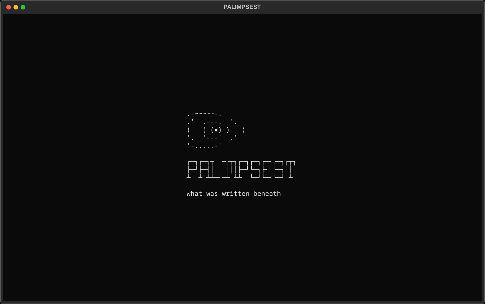
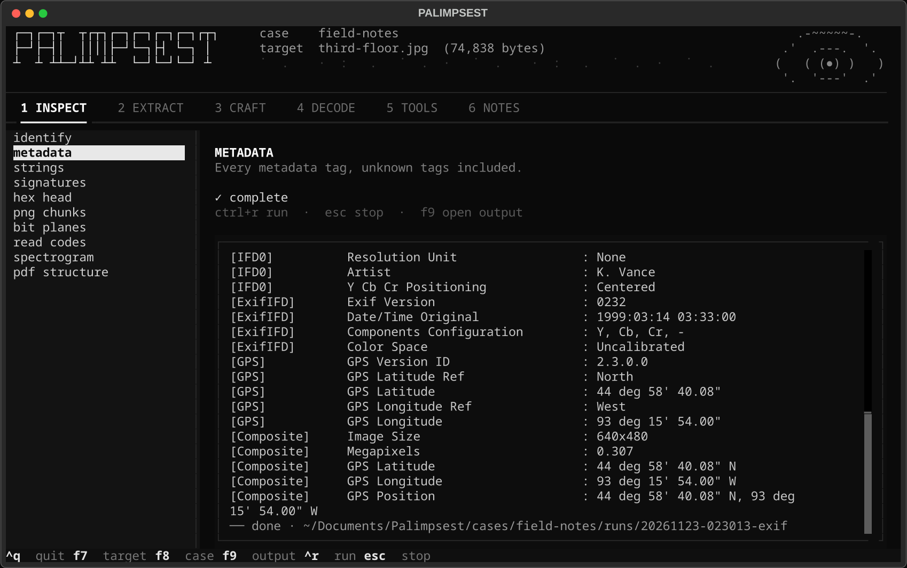
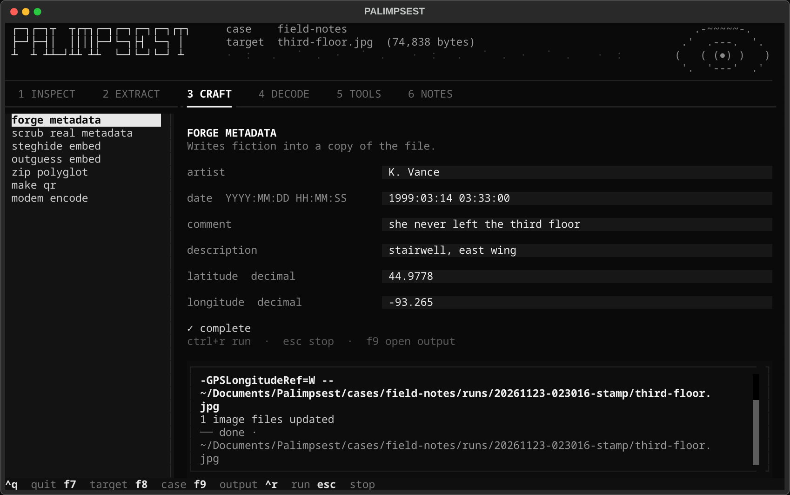
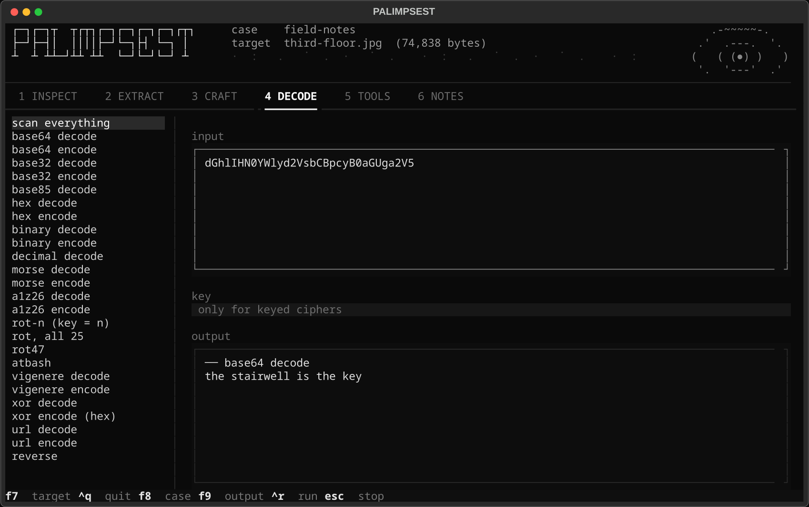
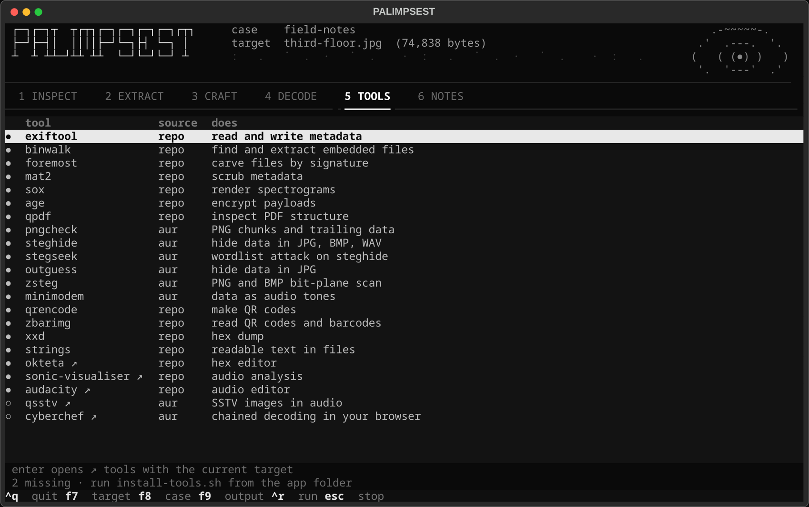

<div align="center">



# PALIMPSEST

**A monochrome terminal workbench for investigating files and building ARGs.**

Read what a file is hiding, or hide something in it yourself.

[](https://github.com/numbpill3d/palimpsest/releases/latest)
[](LICENSE)
[](pyproject.toml)

</div>

> *palimpsest (n.): a manuscript scraped clean and written over, with the older text still legible beneath.*

Palimpsest puts ExifTool, binwalk, steghide, zsteg, and about twenty other tools behind one quiet interface, alongside a live cipher bench and per-case notes. It's built for alternate reality game designers, puzzle makers, CTF players, and curious people with strange files.



## What it does

| Section | Use it to |
|---|---|
| **Inspect** | Identify files and read metadata, strings, signatures, hex, PNG chunks, bit planes, QR codes, spectrograms, and PDF structure |
| **Extract** | Pull out embedded files, carve by signature, read steghide and outguess payloads, test a wordlist, and decode modem audio |
| **Craft** | Forge metadata, scrub your real metadata, hide payloads, build image and zip polyglots, and make QR codes and data tones |
| **Decode** | Run 25 live ciphers and encodings, or let *scan everything* try the likely ones |
| **Tools** | See what's installed and open Okteta, Sonic Visualiser, Audacity, QSSTV, or CyberChef |
| **Notes** | Keep an autosaving Markdown notebook for each case |

<table>
<tr>
<td></td>
<td></td>
</tr>
<tr>
<td align="center"><sub>Write a fictional history into a copy of a file</sub></td>
<td align="center"><sub>Paste a string and scan it</sub></td>
</tr>
</table>



## Built to be careful with evidence

- **Originals stay untouched.** Operations that write work on a copy or create a new file.
- **Every run gets its own folder**, with output and a transcript, under `~/Documents/Palimpsest/cases/<case>/runs/`.
- **No shell is involved.** Filenames with spaces or quotes are passed safely as arguments.
- **Hostile output is defused.** Terminal control sequences are stripped from anything a file or tool prints.
- **Embeds are checked.** A steghide embed only reports success if the payload reads back byte for byte.

## Install

Palimpsest needs Linux, Python 3.11 or newer, and ideally [kitty](https://sw.kovidgoyal.net/kitty/). It was developed on Arch with KDE Plasma.

```bash
git clone https://github.com/numbpill3d/palimpsest.git
cd palimpsest
./install.sh
```

This creates a private virtual environment, adds the `palimpsest` command to `~/.local/bin`, and adds an app menu entry. It doesn't need root.

On Arch, this installs the external tools with `pacman` and [`yay`](https://github.com/Jguer/yay):

```bash
./install-tools.sh
```

On other distributions, install what you want from your package manager. Missing tools are dimmed in the app with the package they need, and everything else keeps working.

## Keys

| Key | Action |
|---|---|
| `F1`–`F6` or `1`–`6` | Switch section |
| `F7` | Open a target file |
| `F8` | Switch or create a case |
| `F9` | Open the latest output folder |
| `Ctrl+R` | Run the selected operation |
| `Esc` | Stop a running tool |
| `Ctrl+Q` | Quit |

You can also open a file directly with `palimpsest path/to/file`.

## Tips for ARG makers

- **Test on the real platform.** Most social platforms strip metadata and recompress images, which destroys hidden data. Host puzzle files yourself and download them again to check.
- **Scrub first, forge second.** Remove your real name, device, and location before adding fictional metadata.
- **Use passphrases from earlier clues.** Common passwords fall to a wordlist in seconds.
- **Keep a fair trail.** Hint at each technique, and keep a private solution path in the case notes.

## Known issues

- The Arch `steghide` build can print `stack smashing detected` after writing a valid file. Palimpsest verifies the payload and reports the real result.
- The AUR `outguess` package may fail on GCC 16. Building from source with `CC='gcc -std=gnu17'` and `--with-generic-jconfig` works.

## Responsible use

Use Palimpsest on files you own or have permission to examine. Forged metadata belongs in fiction and games, so don't use it to deceive people about real events or to fake evidence.

## License

[MIT](LICENSE)
